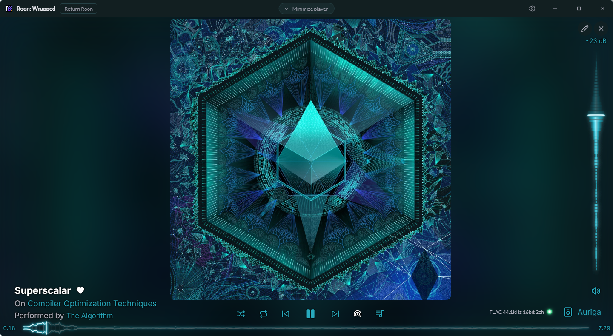
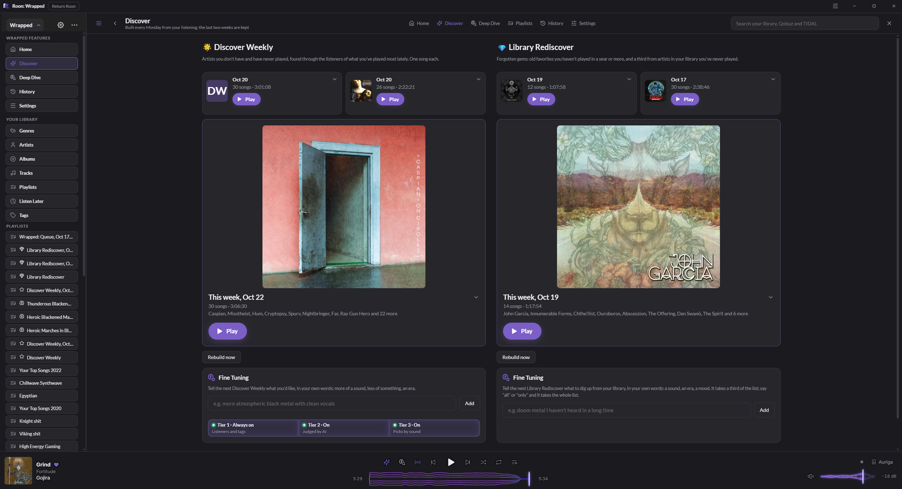
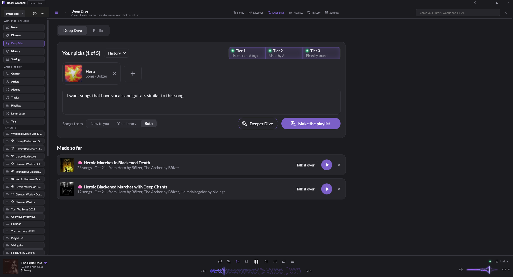
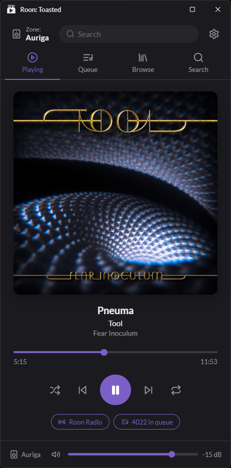
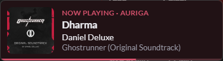
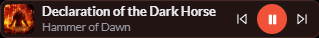

# Roon: Toasted

A Roon companion for Windows that lives in the tray. Press a hotkey to open a
small player with now playing, your queue, browse and search, get a "now
playing" toast when the track changes, put a mini player on your taskbar, or
wrap the Roon app itself in a window with a Now Playing screen you design
yourself: your layout, fonts, colors and animated bars.
It works on its own, no Stream Deck needed, and pairs with
[Roon: Dialed Up](https://marketplace.elgato.com/product/roon-dialed-up-f76699d9-4266-4d4a-ad94-eaddd148daa9)
if you have a Stream Deck.

It has four parts, each of which you can switch on or off.

## Roon: Wrapped (experimental)

**Roon, your way.** The Wrapper puts the Roon app inside a Toasted window and
gives it a player you design yourself. Everything Roon can do is still right
there; what changes is how your music looks while it plays, and Wrapped's own
pages add weekly discovery playlists, Deep Dive playlists made to order and
your whole listening history (see [Wrapped's own pages](#wrappeds-own-pages)).

<p align="center">
  
</p>

<p align="center">
  
  </p>
  <p align="center">
    
</p>

- **A full-window Now Playing you lay out yourself.** Click the album art in
  the player bar, then the pencil: move and resize the art, track info,
  controls, seek bar, zone, quality light and volume anywhere on the screen.
- **Your fonts, icons and colors.** Pick a font per piece (bundled, or any font
  on your PC), an icon pack (Lucide, Phosphor, Tabler, Material Symbols, Remix),
  a plain or circled play button, and black outlines or glows for text and
  icons. Colors follow the app, the playing album's art, or a color you pick.
- **Styles for the seek bar and volume**, in one list: the simple Line, Thick,
  Hairline and Segments; Roon, Pills, Peak caps, Pixel, Stitch, LED meter,
  Solid shape, Line graph, Contour, Neon outline, Neon tube, Wave, Spectrum,
  Beam, Glow line, Ribbon and Album art; and the animated-only Mountains,
  Particles and Plasma. The animated ones come alive around the playhead
  while music plays.
- **Real waveforms:** with Hearts & Library on, the seek bar's Waveform switch
  shows a local file's actual waveform from Roon in most styles, optionally
  bouncing near the playhead, colored by loudness, and as Roon has it or more
  dynamic.
- **Profiles:** save layouts and switch between them, or start from the
  Default, Waves and Waves Large presets. The player bar along the bottom can
  follow the same style.

Switch it on in **Settings > The Wrapper**, then open it from the tray, with
Ctrl + Alt + W, or from Settings. Closing it keeps Roon running out of sight,
so it reopens instantly. **Return Roon** gives Roon its own window back; an
**Enable Wrapper** button then sits in Roon's title bar to wrap it up again.
Only want the Wrapper? Switch the Toaster off in **Settings > Toaster**, and its
hotkeys and links open the Wrapper instead.

### Wrapped's own pages

**Your listening, put to work.** The Wrapped button over Roon's logo opens
Wrapped's pages right next to Roon, and its arrow drops down Wrapped's side
menu (Settings' **Default Menu** picks which side menu, and page, show when the
Wrapper opens). They run on the Hearts & Library link.

- **Home:** your Wrapped playlists, your week, artists for you, new albums
  from the artists you listen to and from ones you may like, newer albums from
  your favorite artists you may have missed, forgotten favorites, and what you
  played on this day in earlier years.
- **Discover:** every Monday, Discover Weekly (artists you've never played,
  one song each) and Library Rediscover (favorites you haven't played in a year
  or more, plus artists in your library you've never played), saved as Roon
  playlists. Rate a song with the thumbs in the player and the next lists
  follow; Fine Tuning takes requests in your own words.
- **Deep Dive:** a playlist made to order from the songs, albums or artists
  you pick and what you ask for, from new music, your library or both.
  Deeper Dive asks a few questions first, Talk it over changes one you've
  made, and Smart Radio needs nothing but the picks.
  **Tiers:** discovery gets smarter with each tier you set up in Wrapped's
- Settings. Tier 1 works from Last.fm listeners and tags (a free key), tier 2
  reads up on each pick with a language model (Anthropic, OpenAI, Gemini, or
  Ollama on your own PC), and tier 3 listens to the songs, your own files
  first. Lights on Discover and Deep Dive show what each tier has.
- **History:** everything you've played in Roon, plus your Last.fm scrobbles
  from before, with your top artists, albums and tracks for any stretch of
  time.
- **Your library:** Genres (from the artists' tags), Artists, Albums, Tracks
  (with a shuffle of its own), Playlists, Listen Later and Tags, and album and
  artist pages with similar artists, tags and play menus.
- **In the player:** Discover and Deep Dive buttons left of the controls, the
  heart right after the song's name, and in Now Playing a Wrapped menu with
  Discover, Deep Dive, the artist and the album.
- **Onboarding:** a short walkthrough the first time you open each part.
  Replay it or switch it off in Settings.
- **Live albums:** off by default, which leaves live albums out of everything
  Wrapped picks for you.

Tier 2 with an online service uses your own key, and the names of songs and
artists go to that service. Tiers 2 and 3 are optional.

The Wrapper works with Roon's own window, and Wrapped's pages and the hearts
use a part of Roon that isn't open to apps, so a Roon update could change how
they behave. They're experimental for that reason.

## The Toaster

A small player that opens from the tray, a hotkey (Ctrl + Alt + Z) or a
`roon-toasted://` link, and goes back to the tray when you're done.

<p align="center">
  
</p>

- **Now playing, queue, browse and search** for any zone, with playback,
  volume, shuffle, repeat, Roon Radio and zone controls.
- **Search hotkey:** Ctrl + Alt + S opens it ready to type (or opens Roon's own
  search in the Wrapper, if you prefer).
- **Hearts & Library** (experimental): heart the playing track or album, or add
  it to your library, and see the audio quality light (Low Quality, CD Quality,
  Hi-Res).
- **Auto-Hide:** it goes back to the tray when you click elsewhere (or stays on
  the taskbar if you turn that off). Zoom, light and dark themes, and a window
  that fits your screen.

## Toasts

A "now playing" toast when the track changes. Click one to open the Toaster
(or the Wrapper).

<p align="center">
  
</p>

- In the corner and on the monitor you choose, for as long as you like (2 to 30
  seconds).
- They stay out of the way of full-screen games.

## Taskbar Widget (experimental)

A small player on your main taskbar with art, title, artist and playback
buttons.

<p align="center">
  
</p>

- Choose the side, position, width and one or two lines of text.

## Everywhere

- **Album Art colors:** the Toaster, toasts, widget and Wrapper can take their
  colors from the album that's playing.
- **Main artist only:** tracks with a long list of supporting artists show just
  the main one (Settings > General > Artists).
- **Hotkeys** for the Toaster, Search and the Wrapper; all can be changed or
  turned off.
- **Tray menu** with Toaster, Wrapper and Taskbar Widget switches, plus Toasts
  and Start with Windows.

## Install

1. Download the latest installer from the
   [Releases page](https://github.com/Vulkandr/roon-toasted/releases) and run
   it. It installs for your user only and doesn't need administrator rights.
2. Start Roon: Toasted. It appears in the tray, and Settings opens the first
   time to help you connect.
3. In Roon, go to **Settings > Extensions** and enable **Roon: Toasted**. That's
   all the setup there is.
4. Double-click the tray icon (or press Ctrl + Alt + Z) to open the Toaster.

To uninstall, use **Apps & Features** in Windows, or run the installer again
and choose to uninstall. The uninstaller has an unticked checkbox to also delete
the app's settings.

### Windows may warn you

The installer isn't code-signed yet (a certificate costs money, and this is a
free hobby project), so:

- **SmartScreen** may say "Windows protected your PC". Choose **More info**,
  then **Run anyway**.
- Some antivirus programs flag new, unsigned apps by mistake. If yours does,
  the full source is right here to inspect, and you can allow the app or build
  it yourself (see below).

### Requirements

- Windows 11 (built and tested there). Windows 10 should work but hasn't been
  tested, and doesn't get rounded corners.
- A Roon Core on your network (Roon 2.x).
- Mac and Linux aren't supported, may be added later.

## Stream Deck

Do you have a Stream Deck? **Roon: Dialed Up** puts Roon on your Stream Deck
buttons and dials, and can open the Toaster (or Search) from a button when
Roon: Toasted is installed:
[Roon: Dialed Up on the Elgato Marketplace](https://marketplace.elgato.com/product/roon-dialed-up-f76699d9-4266-4d4a-ad94-eaddd148daa9).

### Links for other apps

Other apps can open the Toaster with these links:

| Link | What it does |
|---|---|
| `roon-toasted://toggle` | Opens the Toaster, or hides it if it's open and in front |
| `roon-toasted://open` | Opens the Toaster on the Playing tab |
| `roon-toasted://search` | Opens the Toaster on Search, ready to type |

The app registers these links for the current user every time it starts.

### Status check for other apps

While Roon: Toasted is running, `http://127.0.0.1:58421/status` (this PC only)
answers with JSON, so other apps can tell it's running:

```json
{ "app": "Roon: Toasted", "version": "1.0.0", "roon": "connected", "core": "Roon Optimized Core Kit" }
```

`roon` is `connected`, `searching` or `reconnecting`; `core` is the Core's name
once connected, otherwise `null`. No answer means it isn't running.

## Good to know

- Roon doesn't share everything with extensions. Hearts, library, audio
  quality and waveforms come from Roon's internal protocol instead, which is
  why they're experimental (Settings > Hearts & Library). There's still no
  queue reordering or clearing, and the Toaster can't open a specific page in
  the Roon app (the Wrapper can, since Roon is right there).
- Toasts are skipped while a game runs in exclusive full-screen mode, because
  showing one would minimize the game. Borderless windowed games get them.
- The taskbar widget is experimental. Windows doesn't officially allow apps to
  add to the taskbar, so the widget floats over it and may misbehave, for
  example after a display change.
- Roon: Toasted only talks to your Roon Core on your own network. The status
  check only answers on your own PC.
- Can't find your Core? Press Search in Settings > Roon Core. If that doesn't
  help, press Manual and type the Core's IP address (leave the port alone
  unless you changed it in Roon). Diagnostics, at the bottom of the same
  card, shows which network adapters were searched and which answered; Copy
  puts that on the clipboard for a bug report.

## Building

Needs [Rust](https://rustup.rs), [Node.js](https://nodejs.org) and the
Microsoft C++ Build Tools.

```
npm install
npm run tauri dev      # run it while developing
npm run tauri build    # build the installer (src-tauri/target/release/bundle/nsis)
```

Run it from a normal (not administrator) terminal. Some antivirus programs
quarantine Rust build scripts by mistake; if a build hangs or fails oddly,
allow the `src-tauri/target` folder.

App icons are generated from `branding/app-icon-1024.png` with `npx tauri icon`;
`src-tauri/icons/icon.ico` and `tray.ico` also use the simplified drawing
(`branding/app-icon-small-1024.png`, `branding/logo-mask-small-1024.png`) at
small sizes.

### Releasing

Updates are signed, so a build meant for release needs the private key (kept
outside the repo, never committed) in the environment. In PowerShell:

```
$env:TAURI_SIGNING_PRIVATE_KEY = "$HOME\.tauri\roon-toasted.key"
$env:TAURI_SIGNING_PRIVATE_KEY_PASSWORD = "<the key's password>"
npm run tauri build
node scripts/latest-json.mjs
```

The build writes the installer and its `.sig` to
`src-tauri/target/release/bundle/nsis`; the script adds `latest.json` there
(version, release notes from `RELEASE_NOTES.md`, the installer's URL and
signature). Upload all three to a GitHub release tagged `v<version>`. Installed
copies check that release for a newer version and offer it in Settings.

Before building, bump the version in `src-tauri/tauri.conf.json`,
`src-tauri/Cargo.toml`, `package.json` and `package-lock.json`, and write the
release notes to `RELEASE_NOTES.md` (also the text for the GitHub release).

## License

Roon: Toasted is licensed under the [Mozilla Public License 2.0](LICENSE).
In short, you can use, change and share it, including inside larger projects
under other licenses; if you share changed versions of these source files, those
files stay under the MPL.

If the Roon team would like to use any part of this project, whether the code
or just the ideas, I'd be glad to hear from you. Get in touch through my GitHub
profile ([Vulkandr](https://github.com/Vulkandr)) and we can work out terms
that suit you.

## Credits

- Built with [Tauri](https://tauri.app) (MIT or Apache-2.0).
- Roon connection: [roon-api and roon-sood](https://github.com/shin1ohno/roon-rs)
  by shin1ohno (MIT or Apache-2.0). Patched copies of both are included in
  `src-tauri/vendor` under their own licenses; see `VENDORED.md` in each folder
  for the changes.
- Icons in the interface: [Lucide](https://lucide.dev) (ISC license).
- Fonts: [Gloock](https://fonts.google.com/specimen/Gloock),
  [Lato](https://fonts.google.com/specimen/Lato) and
  [Noto Sans](https://fonts.google.com/noto/specimen/Noto+Sans), all under the
  SIL Open Font License 1.1 (license files in `src/assets/fonts`), packaged by
  [Fontsource](https://fontsource.org).

Roon is a trademark of Roon Labs LLC. Roon: Toasted is an independent project,
not made or endorsed by Roon Labs.
